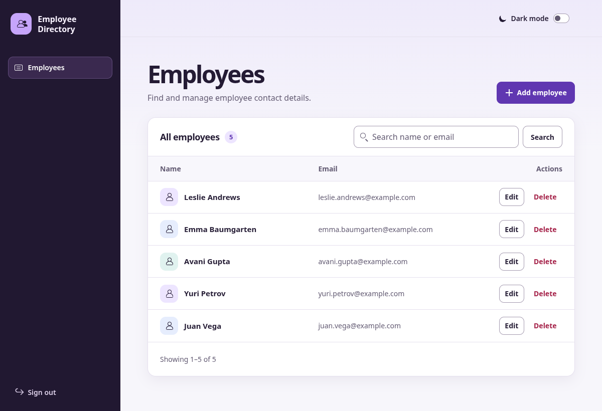
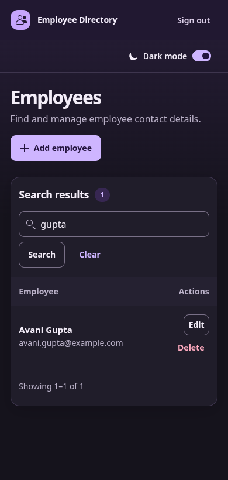

# Employee Directory

A Spring Boot web app for managing employee contact records. Administrators can search by name or email, add and edit records, and remove employees after confirmation.

[Features](#features) · [Run locally](#run-locally) · [Tests](#tests) · [Code guide](#code-guide)

## Preview

<table>
  <thead>
    <tr>
      <th scope="col">Desktop directory</th>
      <th scope="col">Mobile search in dark mode</th>
    </tr>
  </thead>
  <tbody>
    <tr>
      <td valign="top"></td>
      <td valign="top"></td>
    </tr>
  </tbody>
</table>

## Features

- **Search and browse.** Find records by first name, last name, or email. Search is case-insensitive and results are sorted by last name, 10 per page.
- **Maintain records.** Add, edit, or delete employee contact details. Forms validate required fields, email format, and field lengths. Invalid submissions keep the entered values and show errors next to the affected fields.
- **Admin access.** Spring Security requires an administrator sign-in to use the directory and applies CSRF protection to form submissions.
- **Use the directory on desktop or mobile.** Dark mode follows the device preference until you choose a theme, then remembers your choice in the browser.

## Run locally

You’ll need **Java 25**, **Git**, and a **running MySQL server** reachable on `localhost:3306`. The included Maven Wrapper handles Maven.

### 1. Clone the repository

```bash
git clone https://github.com/MohanKalia/Employee-Controller-MVC-Thymleaf.git
cd Employee-Controller-MVC-Thymleaf
```

### 2. Create the database and load the sample records

Run the import with a MySQL account that can create the database and its table. On Windows, run this command in Command Prompt.

```bash
mysql -u YOUR_MYSQL_USER -p < sql-scripts/employee-directory.sql
```

**Use this script on a fresh local database.** It recreates the `employee` table and replaces its contents with five sample records each time it runs.

### 3. Configure the application

Create a `.env` file in the repository root. Replace the placeholder values with your MySQL login and a password for the directory administrator.

```dotenv
DATABASE_USERNAME=your_mysql_username
DATABASE_PASSWORD=your_mysql_password
DIRECTORY_ADMIN_USERNAME=admin
DIRECTORY_ADMIN_PASSWORD=choose_a_strong_password
```

Use plain `KEY=value` entries without surrounding quotes, or set the same values as environment variables. The MySQL account needs read and write access to `employee_directory`. The directory username defaults to `admin` and its password is required. Keep `.env` out of version control.

### 4. Start the app

```bash
./mvnw spring-boot:run
```

On Windows, run `mvnw.cmd spring-boot:run` from Command Prompt. Open [the employee directory](http://localhost:8080/employees/list) and sign in with the directory administrator credentials.

## Tests

```bash
./mvnw -B verify
```

On Windows, run `mvnw.cmd -B verify`. The test suite uses an **in-memory H2 database** and isolated test credentials, so it runs without MySQL or a `.env` file. [GitHub Actions](.github/workflows/test.yml) runs the same verification on pushes and pull requests.

| Suite | Coverage |
| --- | --- |
| [MVC integration tests](src/test/java/com/example/springboot/ThymeleafMVC/EmployeeDirectoryIntegrationTests.java) | Sign-in, role checks, CSRF protection, employee CRUD, search and pagination, invalid edits, missing records, and rendered Thymeleaf pages |
| [Validation tests](src/test/java/com/example/springboot/ThymeleafMVC/EmployeeValidationTests.java) | Required fields, email format, and valid submissions |

## Code guide

The app uses **Java 25, Spring Boot 4, Spring MVC, Thymeleaf, Spring Security, Spring Data JPA, and MySQL**. CSS and vanilla JavaScript handle the responsive layout, theme switching, and enhanced delete confirmation.

An employee request goes through the MVC controller and service to the JPA repository. For page requests, the controller passes the data to Thymeleaf. Successful saves and deletes redirect back to the directory.

| Start here | What it does |
| --- | --- |
| [Employee controller](src/main/java/com/example/springboot/ThymeleafMVC/controller/EmployeeController.java) | Maps list, search, and form requests and handles pagination and validation errors |
| [Employee service](src/main/java/com/example/springboot/ThymeleafMVC/service/EmployeeServiceImpl.java) and [repository](src/main/java/com/example/springboot/ThymeleafMVC/dao/EmployeeRepository.java) | Handle employee lookups, changes, and case-insensitive search |
| [Security configuration](src/main/java/com/example/springboot/ThymeleafMVC/config/SecurityConfiguration.java) | Configures the administrator account, sign-in, and access rules |
| [Thymeleaf templates](src/main/resources/templates) and [static assets](src/main/resources/static) | Render the directory, forms, and error page and supply the styles and interactions |
| [Database script](sql-scripts/employee-directory.sql) | Creates the MySQL schema and loads the sample directory |
